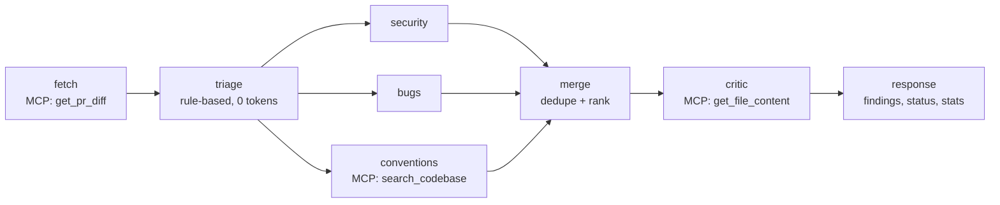

# PR Reviewer Agent

Multi-agent code review service. A Spring Boot app ([`pr-reviewer`](https://github.com/vidhanshu37/pr-reviewer)) receives GitHub pull-request webhooks and calls this service; specialist LLM agents review the diff, a critic agent verifies every finding against the real source, and the structured result goes back to be posted as a PR comment.

The agents never touch GitHub directly. They read the repository only through the MCP server exposed by `pr-reviewer` (read-only tools, one short-lived scoped JWT per review).

## How a review runs



1. **fetch**: pulls the PR diff through MCP.
2. **triage**: picks the specialists from file paths and added lines (no LLM call).
3. **specialists**: `security`, `bugs`, `conventions` review the diff in slices. `conventions` can call `search_codebase` to see how the repo normally does things. Findings that point at lines the model could not have seen are dropped.
4. **merge**: one finding per file and line, most reliable first.
5. **critic**: re-reads the real file around each finding and marks it `confirmed`, `uncertain`, or removes it with a quoted reason.
6. **response**: findings, a status, and per-node stats (calls, tokens, wall time, coverage).

Specialists run one after another by default. Set `AGENT_PARALLEL=1` to run them at the same time (use it with a provider that has no tight tokens-per-minute limit).

## API

| Method | Path | Purpose |
|---|---|---|
| `POST` | `/review` | Review one pull request |
| `GET` | `/health` | Liveness check |

Request: `{"job_id": "...", "repo": "owner/name", "pr_number": 42, "mcp_token": "<job JWT>"}`

Response (shortened):

```json
{
  "job_id": "...",
  "status": "done",
  "findings": [
    {"file": "src/A.java", "line": 12, "severity": "high", "category": "bug",
     "confidence": "high", "message": "...", "suggestion": "...", "verdict": "confirmed"}
  ],
  "warnings": [],
  "stats": {"totals": {"calls": 5, "tokens": 0, "wall_s": 0.0}, "nodes": [], "critic": {}},
  "error": null
}
```

| `status` | Meaning |
|---|---|
| `done` | every selected specialist ran |
| `partial` | a specialist failed (quota, bad reply): its findings are missing and `warnings` says which. Never reported as a clean review |
| `failed` | no review at all (for example the MCP server was unreachable) |

`confidence` is `high` (sure) or `possible` (plausible, depends on code the model cannot see). `verdict` is `confirmed`, `uncertain`, or `null` when the critic did not run.

## Design decisions

- **Verification over confidence.** A second agent checks each finding against the real file. In one observed run, 4 findings were reported, 1 was real and 3 were wrong; the critic confirmed the real one and left the other three `uncertain`.
- **Fail visible, not silent.** A failing specialist makes the status `partial`. A failing critic only adds a warning (findings stay, without a verdict).
- **Hallucination guard.** Findings must point at a line the PR added, otherwise they are dropped.
- **LLM client.** Retry with backoff and `Retry-After`, a sliding token-per-minute window for rate-limited providers, and an on-disk cache that stores only valid answers.
- **Provider switch.** One client, two providers: NVIDIA (`nvidia/nemotron-3-ultra-550b-a55b`, OpenAI-compatible API) or Groq (`openai/gpt-oss-20b`).

## Configuration

Copy `.env.example` to `.env`. The main settings:

| Variable | Default | Purpose |
|---|---|---|
| `LLM_PROVIDER` | `groq` | `nvidia` or `groq` |
| `NVIDIA_API_KEY` | none | required when `LLM_PROVIDER=nvidia` |
| `NVIDIA_THINKING` | `0` | `1` turns on the model's reasoning mode |
| `NVIDIA_MEDIUM_EFFORT` | `0` | with thinking on, a cheaper reasoning level |
| `GROQ_API_KEY` | none | required when `LLM_PROVIDER=groq` |
| `LLM_TPM_LIMIT` | `7000` | tokens-per-minute pacing; tuned for Groq, set very high for NVIDIA |
| `LLM_MAX_OUTPUT_TOKENS` | `1500` | raise it when thinking is on |
| `AGENT_PARALLEL` | `0` | run the specialists concurrently |
| `MCP_URL` | `http://localhost:8081/mcp` | MCP server of `pr-reviewer` |
| `LLM_CACHE` | `1` | disk cache in `.cache/llm` |

Slice sizes, batch limits and critic limits are also environment variables; see `pr_reviewer_agent/config.py`.

## Run

The full system (Spring app, Postgres, Redis, this service) is started from the `pr-reviewer` repo: see its [setup guide](https://github.com/vidhanshu37/pr-reviewer/blob/main/docs/SETUP.md).

Standalone (needs a running MCP server and a valid job token, so mainly for development):

```bash
uv sync
cp .env.example .env        # then fill in the key
uv run uvicorn pr_reviewer_agent.main:app --port 8000
curl http://localhost:8000/health
```

Tests (a fake LLM and a fake MCP, no network or keys needed):

```bash
uv run pytest tests -q
```

Spikes against the real LLM:

```bash
uv run python pr_reviewer_agent/spikes/critic_smoke.py          # 3 hand-made critic cases
uv run python pr_reviewer_agent/spikes/print_graph.py --parallel  # draw the graph
```

## Layout

```
pr_reviewer_agent/
  main.py          FastAPI app, /review, /health
  graph.py         LangGraph wiring (sequential and parallel)
  triage.py        rule-based specialist selection
  specialists/     security, bugs, conventions (+ shared runner)
  merge.py  critic.py  stats.py
  llm.py           provider switch, pacing, retry, cache
  mcp_client.py    MCP tool calls
  prompts.py  schemas.py  slicing.py  annotate.py  config.py
tests/             fake-LLM and fake-MCP tests
```

## Status and limitations

- **No precision/recall numbers yet.** An evaluation on real pull requests is the next step. Until then, treat `verdict: confirmed` as stronger than `uncertain`, not as proof.
- **False positives happen.** In particular, models make confident but wrong claims about library APIs. The critic catches some of them, not all.
- **Triage is rule-based.** A file with plain string-concatenated SQL or `os.system` calls may not be routed to the security specialist.
- **Large PRs are reviewed in part.** `coverage` is reported per specialist in `stats`; the conventions check in particular may see only some files.
- **Prompt-injection hardening is incomplete.** Code retrieved from the repository is passed to the model as context and should be treated as untrusted input.
- **Free-tier providers.** NVIDIA's hosted API is a trial service with its own terms and rate limits, and the reviewed code is sent to the chosen provider.